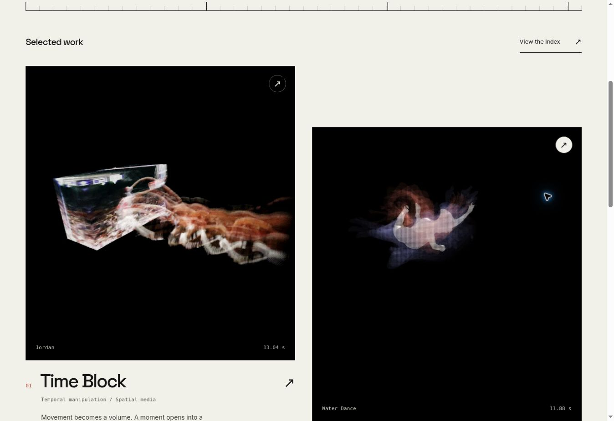

# Review record — Temporal Atlas

## Scope

Approved direction B, implemented on `feat/temporal-atlas` from main commit
`60d64b8a18787e4872d598f7be9c8c63f360f16e`. No production merge, deployment,
Cloudflare dashboard change, or replacement of the original model is included.

Confirmed media mapping: `water_dance_2_HQ.mp4` → **Depth Echo / Water Dance**;
`jordan_render_instagram.mp4` → **Time Block / Jordan**.

## Current revision

The monochrome design and render intro remain in place. Project descriptions,
Lab pages, and Lab links are removed. About now contains Pietro's supplied text
and the original point cloud. Retired Lab URLs temporarily redirect to About or
Work; there are six content pages plus the 404.

- TypeScript and Vite production build pass; seven HTML pages and sitemap generated.
- All five automated test groups pass, including retired routes, redirects,
  removal of Lab navigation, and the point cloud appearing only on About.
- Original model matches main byte-for-byte in Git (blob
  `f963a58bbebe47c3695748b845bdea351e03c390`, 22,571,332 bytes). Camera, model scale,
  and point-cloud settings remain those of the live site's original viewer.
- Entry JavaScript is 3.85 kB minified / 1.66 kB gzip. The frame-study tool is no
  longer bundled. Styles are 22.87 kB / 5.52 kB; About viewer controls are
  4.76 kB / 2.13 kB; the optional 3D engine is 744.24 kB / 189.89 kB.
- `git diff --check` passes. Preview browser checks are recorded on the draft PR.

## Earlier baseline checks

- TypeScript and Vite production build pass; ten HTML pages and sitemap generated.
- Five automated test groups pass: route/metadata structure, internal navigation
  and assets, media mapping/loading, 404 behavior, and entry performance budget.
- `npm audit` reports zero known vulnerabilities after compatible dependency updates.
- Both MP4s fully decode with FFmpeg; fast-start metadata is present before media
  data. Jordan is 1,906,688 bytes; Water Dance is 620,119 bytes. Combined: 2.53 MB
  decimal, about 82% smaller than the 14.09 MB supplied originals.
- Browser playback and frame stepping were exercised. The source selector maps
  both films correctly, changes the project link, resets controls, and updates
  the URL. Jordan advances approximately 0.0417 seconds per frame.
- Desktop navigation from homepage to project, project to Lab, film selection,
  and return to the corresponding project were checked. Production HTML was
  served locally for the final homepage and case-study check.
- Phone/tablet iframe viewports of 320, 390, 768, and 1024 px were inspected across
  the nine content pages. A narrow Lab-title overflow was found and corrected;
  the 320 px Lab and 1024 px homepage were explicitly rechecked. These are browser
  layout checks, not tests on physical mobile hardware.
- The mobile menu opens, reveals normal links, updates its expanded state, and
  closes on Escape with focus returned to the trigger.
- The browser has no WebGL2 support. The viewer's unavailable-device fallback
  appears, with working alternative links and an option to retry.
- Original model is unchanged in Git and remains 22,571,332 bytes.
- `git diff --check` passes.

## Earlier baseline measurements

| Resource | Minified | Gzip |
| --- | ---: | ---: |
| Entry JavaScript | 4.05 kB | 1.71 kB |
| Styles | 22.34 kB | 5.39 kB |
| Frame tool, loaded on its page | 3.03 kB | 1.22 kB |
| Spatial controls, loaded on their page | 4.77 kB | 2.12 kB |
| 3D engine, loaded only after activation | 744.24 kB | 189.89 kB |

Vite's large-chunk warning applies to the optional 3D engine. It is intentionally
not preloaded by the homepage. Fonts are self-hosted. Index pages use WebP stills;
video playback uses `preload="none"` and requires visitor interaction. These are
build measurements, not Lighthouse scores or measured Core Web Vitals.

## Before approving production

- Review the current art direction, media presentation, and About layout.
  Supply credits, dates, and tool/download links where desired.
- Test the 3D scene in a GPU-enabled browser: initial camera, visual fidelity,
  keyboard/button controls, drag/pinch, reset, close/reopen, and resource cleanup.
- Exercise an interrupted model download and WebGL context loss on supported
  hardware; inspect fallback and retry behavior.
- Check iOS/Safari, real touch input, and reduced-motion behavior on devices.
- On the Cloudflare preview, verify direct deep links, HTTP 404 status, response
  headers, and run mobile/desktop Lighthouse. Record field metrics after launch.
- Confirm Cloudflare's production branch and resolve the existing separate
  Workers check if it still runs. Do not merge until the owner approves.

